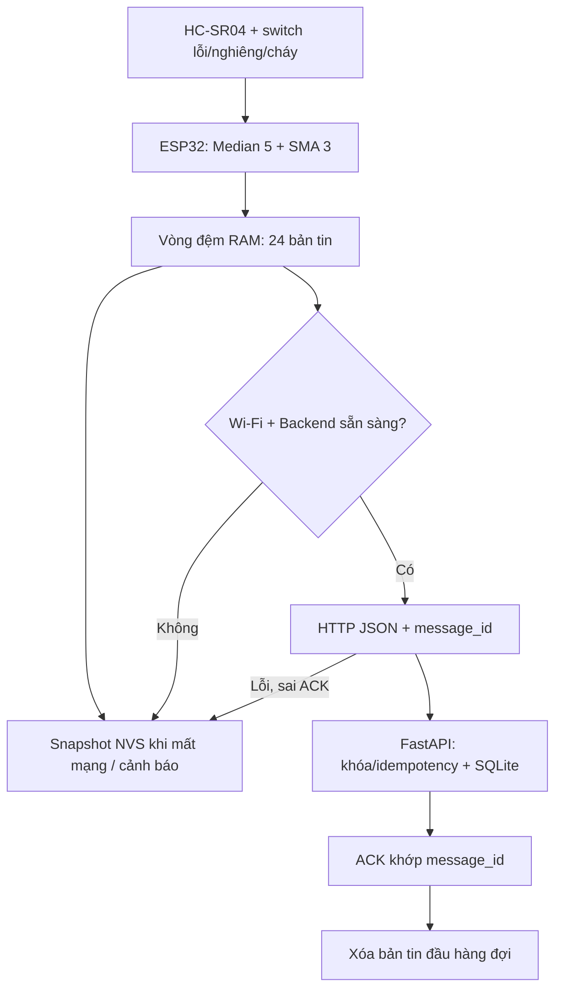

# P2 - Giai đoạn 2: Networking & Edge (SV2)

> **Phạm vi thực hiện:** nâng cấp tuyến truyền **ESP32/Wokwi → Wi-Fi/HTTP JSON → FastAPI/SQLite** của demo hiện có; bổ sung ví dụ **mã hóa payload cho NB-IoT/LoRaWAN**. Dự án **chưa có modem NB-IoT, module LoRa, LoRaWAN gateway/network server, TLS hay cloud thật**, nên tuyệt đối không trình bày việc đó như đã triển khai.

## 1. Đối chiếu yêu cầu của thầy

| Yêu cầu Câu 2B | Giai đoạn 2 cung cấp | Phân loại |
| --- | --- | --- |
| Gói tin tối ưu băng thông (JSON/Protobuf) | JSON rút gọn đang dùng với Wi-Fi/HTTP; codec tham chiếu 19 byte cho payload ứng dụng LoRaWAN (`backend_server/p2_payloads.py`) | JSON **chạy demo**; LoRaWAN **thiết kế/mô phỏng codec**; **không dùng Protobuf** |
| Offline buffering / ring buffer | Bộ đệm vòng ESP32 tối đa 24 bản tin, snapshot NVS, ưu tiên giữ sự kiện khẩn cấp; khôi phục sau reset nếu flash được lưu | **Cài đặt và thử nghiệm logic** |
| Tự đồng bộ khi có mạng | Wi-Fi reconnect, gửi lại FIFO, retry exponential + jitter, backend ACK có `message_id`, SQLite idempotency | **Cài đặt và thử nghiệm API**, cần kiểm thử Wokwi thủ công |

## 2. Kiến trúc dữ liệu và phân ranh trách nhiệm



Các đèn LED và luật định tuyến P0/P1 không đổi. Khi fire/tilt còn kích hoạt, logic đèn của Stage1 tiếp tục áp dụng; không tạo thêm LED hay phần cứng thực tế.

## 3. Cấu trúc bản tin JSON (đang chạy)

Các khóa cũ giữ nguyên. Hai khóa mới ở tầng vận chuyển:

- `message_id`: định danh bất biến theo `BIN_01_MSG_<bootIdHex>_<sequence>`; phát lại giữ nguyên ID, để backend bỏ qua trùng.
- `captured_at_unix` (tùy chọn): số giây UTC kể từ 1970, **chỉ** gửi khi ESP32 đã có giờ NTP hợp lệ. Khác với `measured_at`: thời gian uptime tính bằng giây từ lúc boot. Khi không biết UTC, bỏ hẳn trường này, không biến uptime thành Unix timestamp.

Ví dụ gói tin (JSON không có dấu cách không cần thiết):

```json
{"device_id":"ESP32_NODE_01","bin_id":"BIN_01","message_id":"BIN_01_MSG_1234abcd_73","measured_at":310,"captured_at_unix":1794974400,"distance_cm":60.0,"fill_percent":50.0,"sensor_status":"OK","is_priority":false,"tilt_detected":true,"fire_detected":false}
```

Ví dụ JSON trên có **256 byte UTF-8** sau khi rút gọn, so với **19 byte payload ứng dụng LoRaWAN** đề xuất bên dưới. Đây là hai dạng bản tin ở **những lớp giao thức khác nhau** và không mang thông tin hoàn toàn giống nhau (payload LoRaWAN không chứa tên thiết bị hoặc `measured_at`); không được lấy tỷ lệ 256/19 để kết luận tiết kiệm băng thông vô tuyến thực tế. HTTP/Wi-Fi còn có chi phí header HTTP, TCP và Wi-Fi. `p2_payloads.minified_json()` cho phép tạo và đo JSON tối giản, không cần Protobuf trong demo.

### Payload ứng dụng LoRaWAN đề xuất: đúng 19 byte

`backend_server/p2_payloads.py` có `pack_lorawan_payload`, `unpack_lorawan_payload`, `lorawan_to_telemetry`. Đây chỉ là **mã hóa payload tầng ứng dụng**, không chứa overhead LoRaWAN, DevEUI, AES session keys hay MIC.

| Byte | Trường | Kiểu | Ý nghĩa |
| --- | --- | --- | --- |
| 0 | version | uint8 | Phiên bản = 1 |
| 1 | bin_number | uint8 | Thùng 1–6 |
| 2–5 | sequence | uint32 BE | Số thứ tự bản tin trong phiên boot |
| 6–9 | captured_at_unix | uint32 BE | UTC; bằng `0` khi chưa đồng bộ |
| 10–11 | distance_cm × 10 | uint16 BE | 0.1 cm; `65535` = lỗi sensor |
| 12–13 | fill_percent × 10 | uint16 BE | 0.1%; `65535` = lỗi sensor |
| 14 | flags | uint8 | bit0 sensor error, bit1 ưu tiên, bit2 nghiêng, bit3 cháy |
| 15–18 | boot_id | uint32 BE | Chống trùng sau khởi động lại |

Khi tích hợp LoRaWAN **thật**, backend phải xác minh mạng chủ quản, ánh xạ **DevEUI → `device_id` đã đăng ký**, sau đó mới chuyển payload thành JSON API. Decoder minh họa **không** xác thực thiết bị, không tự vận chuyển qua radio. Phải kiểm tra giới hạn payload theo vùng tần số, data rate và mạng triển khai trước khi áp dụng định dạng 19 byte.

## 4. Chính sách lưu và gửi lại tại Edge

1. Mọi phép đo (thường mỗi 5 giây) được tạo thành `EdgeTelemetryRecord` **22 byte**, gồm boot ID, sequence, uptime, UTC (nếu có), khoảng cách, mức đầy và cờ trạng thái.
2. Hàng đợi `DurableOutbox` có 24 slot. Khi online bình thường, lưu vào RAM; cảnh báo khẩn cấp hoặc khi offline thì ghi snapshot ~540 byte xuống **ESP32 NVS (`Preferences`)**. NVS vẫn giữ các bản tin sau reset khi vùng flash được duy trì.
3. Nếu đủ 24 slot, bản tin bình thường mới bị bỏ. Bản tin khẩn cấp mới có thể thay thế **bản tin bình thường cũ nhất**, không thay bản tin khẩn cấp khác. Nếu cả 24 đều khẩn cấp, bản tin mới cũng bị từ chối; serial in thông báo `CRITICAL OVERFLOW`.
4. Khi có Wi-Fi, gửi **bản tin đầu** (FIFO). Chỉ xóa sau HTTP 2xx **và** JSON ACK có `message_id` khớp cùng `status` thuộc `accepted`, `sensor_error_logged`, `duplicate_ignored`.
5. Nếu HTTP lỗi, backend tắt, hoặc ACK không hợp lệ: giữ nguyên ID/bản tin, đảm bảo snapshot NVS, retry với exponential backoff 1–60 giây cộng jitter 0–399 ms. Khi ACK hợp lệ, trở lại nhịp 200 ms cho bản tin tiếp theo.
6. `telemetry_logs.message_id` là PRIMARY KEY. `BEGIN IMMEDIATE` giúp chặn race khi có hai bản tin trùng đến đồng thời. `telemetry_delivery_audit` ghi thời gian nhận và độ trễ nếu có UTC tin cậy. Dữ liệu, ưu tiên, nhật ký và lịch xe của các giai đoạn trước được giữ nguyên.

**Giới hạn phải nêu trong báo cáo:** 24 slot không thể đảm bảo không mất dữ liệu vô hạn khi mất mạng lâu; NVS có tuổi thọ ghi hữu hạn; ghi nhiều lần/offline lâu cần đánh giá wear leveling và khả năng chịu lỗi. Trạng thái cấp cứu là mô phỏng qua switch, không thay thiết bị an toàn. Tốc độ thực tế chưa đo trên NB-IoT/LoRaWAN. Với hệ thống thực, cần xác thực/TLS trên kênh WAN, gateway đích thực, và phân biệt dữ liệu hiện tại với bản tin lịch sử khi đồng bộ.

## 5. Chạy thử tự động

Trước hết dùng **bản Stage2** của dự án, không chạy script trên bản GitHub cũ.

```powershell
cd "D:\Internet of things\iot_quanLyRacThai"
$env:IOT_P2_PROJECT = (Get-Location).Path
& ".\backend_server\.venv\Scripts\python.exe" "D:\Internet of things\P2_Stage2_Apply\tests\test_p2_stage2.py"
& ".\backend_server\.venv\Scripts\python.exe" "D:\Internet of things\P2_Stage2_Apply\tests\test_p2_stage1.py"
Remove-Item Env:\IOT_P2_PROJECT
```

Đường dẫn `P2_Stage2_Apply` cần khớp thư mục sau khi bạn giải nén. `test_p2_stage1.py` kiểm tra hồi quy 7 bài cũ, `test_p2_stage2.py` kiểm tra 11 ca API/codec mới; các test API dùng **SQLite tạm** và không thay đổi `smart_waste.db` thực. Test firmware qua C++ host có trong gói (`tests/edge_outbox_host.cpp`) đã kiểm tra trước khi đóng gói; để chạy trên Windows cần C++ compiler.

## 6. Test thực tế trên Wokwi + Web (bắt buộc để hoàn tất demo)

1. Đóng mọi instance backend khác; khởi động backend từ project root (giữ cửa sổ PowerShell chạy):

   ```powershell
   cd "D:\Internet of things\iot_quanLyRacThai"
   & ".\backend_server\.venv\Scripts\python.exe" -m uvicorn backend_server.app:app --host 0.0.0.0 --port 8000
   ```

   Dùng `http://127.0.0.1:8000/` trong trình duyệt, **không dùng `0.0.0.0` làm URL**.
2. Mở `esp32_node/esp32_node` bằng VS Code/PlatformIO, chạy mô phỏng Wokwi. Serial cần hiện `P2-Stage2`, WiFi kết nối, `[ACK]` đúng ID, `queue` giảm về 0. Đèn và cảnh báo Stage1 vẫn chạy.
3. Dừng **backend** bằng `Ctrl+C` nhưng **giữ Wokwi đang chạy**. Thử switch **FIRE/TILT**, nút khẩn cấp, chờ khoảng 15–40 giây. Serial phải cho thấy `[HTTP]` và `[RETRY]`, `waiting/queue` tăng, `NVS=1`. Không kỳ vọng Web cập nhật khi backend tắt.
4. Khởi động lại backend, giữ nguyên simulator. Chờ tối đa ~60 giây cho đợt retry đầu tiên. Serial cần hiển thị ACK nhiều `message_id` cũ theo thứ tự, queue giảm dần về 0. Dashboard nhật ký có sự kiện `FIRE_DETECTED`, `TILT_DETECTED` và các sự kiện `*_CLEARED` khi trả công tắc về trạng thái bình thường.
5. Kiểm tra thống kê bằng PowerShell ở terminal **khác**, không in hoặc chia sẻ API key:

   ```powershell
   cd "D:\Internet of things\iot_quanLyRacThai"
   $keyset = Get-Content ".\backend_server\p1_local_keys.json" -Raw | ConvertFrom-Json
   Invoke-RestMethod "http://127.0.0.1:8000/api/network/stats" -Headers @{"X-API-Key" = $keyset.admin_api_key}
   ```

   `total_received` và `recent` tăng khi đồng bộ. `delayed_at_least_30s` chỉ tính được khi NTP đã sẵn sàng **tại lúc ghi bản tin**, nên có thể vẫn bằng 0 trên Wokwi ngay lúc khởi động.
6. **Test reset:** khi offline và `NVS=1`, bấm reset **ESP32** trong một phiên Wokwi và quan sát dòng `[NVS] RESTORED...`; sau đó mở lại backend, kiểm tra ACK. Không tự nhận là kiểm thử mất điện thực nếu Wokwi không giữ flash qua lần dừng/khởi động lại. Để chứng minh chịu mất điện thật cần ESP32 vật lý và flash được bảo toàn.
7. **Test không trùng:** gửi lại cùng `message_id` (hoặc cho thiết bị retry do mất ACK), backend phải trả `duplicate_ignored` và không lặp lại các log `FIRE_DETECTED`.

**Tiêu chí hoàn thành:** 18/18 bài kiểm thử API/Stage1 đạt; test host NVS đạt; quan sát được offline → NVS → retry → ACK → queue=0; P0/P1, dashboard, 2 loại cảnh báo Stage1 không hồi quy; báo cáo có hình Serial/Wokwi/Web và bảng giới hạn trên.
