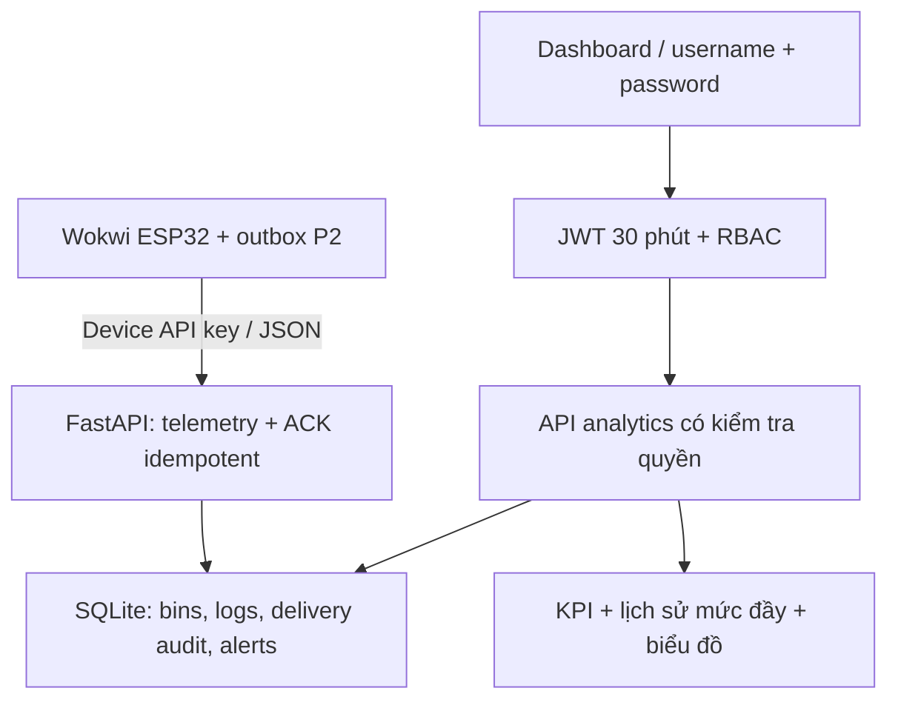

# GIAI ĐOẠN 3 — CLOUD, CSDL & SECURITY (SV3 / Câu 2C)

## 0. Ranh giới cần nói chính xác với giảng viên

**Đã triển khai và kiểm thử:** backend FastAPI + SQLite hiện tại, chỉ mục lịch sử theo thời gian, API thống kê vận hành, dashboard biểu đồ mức đầy theo lịch sử, JWT 30 phút, vai trò `viewer` / `operator` / `admin`, kiểm tra phân quyền trên API và cơ chế khóa API đọc ở chế độ triển khai. Các tính năng P0/P1/P2 vẫn tồn tại.

**Đã cung cấp cấu hình/tham chiếu nhưng chưa vận hành thật:** Caddy reverse proxy dùng HTTPS tự động khi có DNS/TLS hợp lệ; mẫu CSDL PostgreSQL partition theo tháng; hướng dẫn VPS và bảo mật. **Chưa triển khai lên Municipal Waste Management Cloud, chưa có tên miền/chứng chỉ TLS thật, chưa tích hợp PostgreSQL Cloud hay pipeline ETL, chưa thử tải thực địa.** Không trình bày các phần này như đã hoạt động. Hệ thống thực tế vẫn là Wokwi ESP32 → Wi-Fi/HTTP JSON → FastAPI/SQLite.

## 1. Đối chiếu trực tiếp Câu 2C của thầy

| Yêu cầu | Kết quả Giai đoạn 3 | Trạng thái |
| --- | --- | --- |
| Thiết kế CSDL Relational/NoSQL/Time-series tối ưu cho thời gian thực | Giữ nguyên `bins`, `telemetry_logs`, `telemetry_delivery_audit`, `alert_events`, `trip_stops`; thêm index `idx_telemetry_bin_time`, `idx_alert_events_time`, bảng người dùng `dashboard_users`. Truy vấn theo `bin_id` + cửa sổ 1–168h, nhóm thời gian 5/15/60 phút; mẫu PostgreSQL partitioned tại `deployment/postgresql_p3_reference.sql` | **Đang chạy SQLite**, PostgreSQL **thiết kế tham chiếu**; không có NoSQL thật |
| Bảo mật API end-to-end JWT/TLS/RBAC | JWT HS256 với secret ngẫu nhiên sinh riêng trên máy, `exp` 30 phút, issuer/audience, đối chiếu vai trò người dùng mỗi request; PBKDF2 SHA-256 + salt riêng/600k vòng; API thống kê chỉ nhận Bearer; thiết bị tiếp tục dùng device key; mẫu Caddy HTTPS | **JWT/RBAC chạy và có test**; **TLS là cấu hình mẫu, chưa cấp chứng chỉ thật** |
| Giao diện Web/App điều khiển và biểu đồ | Bổ sung form login/logout, 4 KPI thống kê, chọn thùng & 1h/6h/24h/7 ngày, biểu đồ lịch sử không nội suy dữ liệu; giữ bản đồ, điều phối, chart mức đầy hiện tại, chart tuyến và log cảnh báo | **Đã cập nhật Web**; app tài xế là mockup Web, chưa phải app di động native |

## 2. Quyền truy cập và bí mật

| Vai trò | API đọc số liệu | Đặt ưu tiên, mô phỏng, xác nhận thu gom, reset | Tạo/khóa tài khoản |
| --- | --- | --- | --- |
| `viewer` | Được | Không được (`403`) | Không |
| `operator` | Được | Được | Không |
| `admin` | Được | Được | Quản trị qua **CLI cục bộ** |
| ESP32 `X-API-Key` | Chỉ gửi `/api/telemetry` | Không | Không |

`GET /api/analytics/overview`, `GET /api/analytics/history` và `GET /api/auth/me` luôn yêu cầu Bearer token. `POST /api/auth/token` nhận username/password, không gửi password bằng query string; không nhúng password/key vào JS/Git. JWT lưu **trong RAM tab trình duyệt**, reload mất phiên. Mật khẩu lưu hash và salt trong SQLite, secret ký JWT lưu `backend_server/p3_local_auth.json` riêng trên máy, **không commit**.

**Chế độ demo P0/P1/P2 mặc định:** `GET /api/bins`, `GET /api/logs`, `POST /api/routes/optimize` vẫn public để không làm hỏng demo/test cũ, API ghi vẫn chấp nhận legacy admin key. Đây **chưa phải** RBAC toàn tuyến ở cấu hình mặc định.

**Chế độ để triển khai bên ngoài:** đặt đồng thời `IOT_P3_LOCK_READS=1` và `IOT_P3_DISABLE_LEGACY_ADMIN=1` trước khi khởi động FastAPI. Khi đó, các API đọc kể trên yêu cầu JWT (các trang không đăng nhập chỉ xem được login); mutation chỉ cho operator/admin JWT. Thiết bị vẫn xác thực `X-API-Key` riêng. Giữ thiết bị/backend sau TLS proxy hoặc đường truyền riêng; không gửi device key qua mạng công cộng HTTP.

CLI quản lý account không mở endpoint HTTP: `python backend_server/p3_setup.py init-admin`, `python backend_server/p3_setup.py add-user --username user01 --role viewer`, `python backend_server/p3_setup.py disable-user --username user01`, `python backend_server/p3_setup.py revoke-tokens --username user01`. Tất cả thao tác trực tiếp tại máy chủ, password nhập ẩn và yêu cầu ít nhất 12 ký tự. Không có admin mặc định.

**Các biện pháp còn cần cho production:** giới hạn số lần đăng nhập (WAF/reverse proxy), giám sát truy cập, backup DB + secrets mã hóa, luân chuyển secret và mật khẩu, chuẩn hóa múi giờ/đồng hồ, bảo mật firmware/OTA, kiểm tra quyền quản trị vận hành. PBKDF2 là giải pháp thư viện chuẩn tương thích demo; triển khai doanh nghiệp nên dùng thư viện Argon2id và hệ thống định danh tập trung. Cloud Caddy chỉ giải quyết TLS từ trình duyệt → proxy; **không** tự khiến Wi-Fi/HTTP của Wokwi thành TLS.

## 3. Kiến trúc API & dữ liệu



Các bảng/quan hệ vận hành:

- `bins(bin_id PK, device_id, trạng thái, cảnh báo, ưu tiên...)`: trạng thái mới nhất.
- `telemetry_logs(message_id PK, bin_id, device_id, fill_percent, received_at...)`: chuỗi mẫu đo không trùng, đọc theo `(bin_id, received_at DESC)`.
- `telemetry_delivery_audit(message_id PK/FK, captured_at_unix, delivery_delay_seconds...)`: độ trễ mạng P2.
- `alert_events(id PK, bin_id, event_type, created_at...)`: nhật ký biến cố; có index thời gian.
- `trip_stops(bin_id PK, stop_order, action_status...)`: lịch thu gom (đã có từ P0/P1).
- `dashboard_users(username PK, password_salt, password_hash, role, disabled, token_version...)`: đăng nhập và thu hồi JWT.

Lịch sử dùng **`received_at`** (giờ máy chủ), không nhầm với ESP32 uptime `measured_at`. Chỉ lấy `sensor_status='OK'`, mức đầy 0–100; lỗi sensor được loại khỏi đường biểu diễn, nhưng vẫn lưu lịch sử P2 và tính riêng cảnh báo. Không tạo các giá trị khi khoảng thời gian không có phép đo. Gửi lại cùng `message_id` không tăng sample count hay sự kiện nhờ cơ chế idempotent P2.

## 4. Các API mới

| Endpoint | Quyền | Ý nghĩa |
| --- | --- | --- |
| `POST /api/auth/token` | username + password | Cấp access token 30 phút |
| `GET /api/auth/me` | Bearer viewer+ | Kiểm tra phiên, username/role |
| `GET /api/analytics/overview?hours=24` | Bearer viewer+ | Số mẫu, cảnh báo, bản tin trễ, trạng thái |
| `GET /api/analytics/history?bin_id=BIN_01&hours=24&bucket_minutes=15` | Bearer viewer+ | Mẫu đo thực tế theo khung thời gian, AVG/MIN/MAX/count |
| `GET /api/ui/config` | Public | Cấu hình hiển thị chế độ bảo vệ, không trả bí mật |

Giá trị `hours` từ 1–168, `bucket_minutes` thuộc 5/15/60, `bin_id` chỉ nhận `BIN_01`–`BIN_06`; trả `422` nếu đầu vào không hợp lệ.

## 5. Áp dụng Giai đoạn 3 ở Windows trên nhánh đã có P2

1. Đóng backend đang chạy. **Backup SQLite đã có** được installer tạo tự động, không xóa dữ liệu. Đảm bảo các thay đổi của Stage2 đã áp dụng trên `feat/p2-network-edge`, **không dùng lại bản `origin/main` chỉ có Stage1**.
2. Tạo nhánh mới từ trạng thái hiện tại (Git mang theo các file P2 còn uncommitted):

   ```powershell
   cd "D:\Internet of things\iot_quanLyRacThai"
   git status -sb
   git switch -c feat/p3-cloud-security
   ```

3. Giải nén `P3_Stage3_Apply.zip` vào `D:\Internet of things\P3_Stage3_Apply`. Chạy script trong gói (dùng `Get-ChildItem` để tìm đúng khi Windows tạo thêm một tầng thư mục):

   ```powershell
   $patch = Get-ChildItem "D:\Internet of things\P3_Stage3_Apply" -Filter "apply_p3_stage3.py" -Recurse -File | Select-Object -First 1 -ExpandProperty FullName
   & ".\backend_server\.venv\Scripts\python.exe" $patch (Get-Location).Path
   & ".\backend_server\.venv\Scripts\python.exe" -m pip install -r ".\backend_server\requirements_p3.txt"
   ```

4. Tạo admin mới (đặt tên và mật khẩu **của riêng nhóm**, không chia sẻ trên Git):

   ```powershell
   & ".\backend_server\.venv\Scripts\python.exe" ".\backend_server\p3_setup.py" init-admin
   ```

5. Chạy backend (chế độ demo local, giữ Wokwi chạy như cũ):

   ```powershell
   & ".\backend_server\.venv\Scripts\python.exe" -m uvicorn backend_server.app:app --host 0.0.0.0 --port 8000
   ```

   Mở `http://127.0.0.1:8000/` (không dùng URL `0.0.0.0`). Bấm **Đăng nhập** trên header, mở tab **Biểu đồ & Nhật ký**, chọn thùng/khoảng thời gian, nhấn **Cập nhật**. Wokwi cập nhật bản tin 5 giây sẽ tạo lịch sử. Còn 0 mẫu đo thì đường biểu đồ phải trống, không tự tạo số liệu.

## 6. Kiểm thử tự động trước Wokwi

```powershell
cd "D:\Internet of things\iot_quanLyRacThai"
$env:IOT_P2_PROJECT = (Get-Location).Path
$env:IOT_P3_PROJECT = (Get-Location).Path
$testfolder = (Get-ChildItem "D:\Internet of things\P3_Stage3_Apply" -Filter "test_p3_cloud_security.py" -Recurse -File | Select-Object -First 1).Directory.FullName
$py = ".\backend_server\.venv\Scripts\python.exe"
& $py (Join-Path $testfolder "test_p2_stage1.py")
& $py (Join-Path $testfolder "test_p2_stage2.py")
& $py (Join-Path $testfolder "test_p3_cloud_security.py")
Remove-Item Env:\IOT_P2_PROJECT
Remove-Item Env:\IOT_P3_PROJECT
```

Bộ test P3 mới chạy trên SQLite **tạm**, không sửa DB thật; kiểm tra đăng nhập, sai mật khẩu, JWT giả/sửa, thu hồi token, RBAC, mã lỗi, số đo thực, bản tin trùng, migration và mode khóa API. Mọi test cần cùng Python venv đã cài FastAPI/PyJWT.

**Kiểm thử trực quan bổ sung:** tạo 1 `viewer` bằng `add-user`; đăng nhập viewer, bảo đảm xem biểu đồ được nhưng không bật ưu tiên. Đăng nhập `operator`, bật ưu tiên và xác nhận thu gom được. Kiểm thử tắt mạng/Wokwi từ Giai đoạn 2, sau đồng bộ lịch sử tăng đúng số `message_id` mới; Wokwi LED/nghiêng/cháy không thay đổi.

## 7. Mẫu triển khai VPS + HTTPS (cần nhóm tự cấu hình)

1. Cấp VPS/domain do nhóm sở hữu; trỏ DNS đến VPS, mở TCP 80/443, bảo vệ SSH; không công khai port 8000.
2. Cài Python/venv và phụ thuộc, đặt repo trong thư mục riêng có quyền thấp; cấu hình `p1_local_keys.json`, `p3_local_auth.json` và SQLite/backup được bảo vệ chỉ cho service account đọc/ghi. Giữ **một tiến trình SQLite writer** phù hợp demo, chưa có mở rộng nhiều instance.
3. Khởi động API chỉ trên loopback `127.0.0.1:8000` với hai biến môi trường `IOT_P3_LOCK_READS=1` và `IOT_P3_DISABLE_LEGACY_ADMIN=1`.
4. Dùng `deployment/Caddyfile.example` (đổi `waste.example.org` thành domain thật) để Caddy lấy chứng chỉ HTTPS khi DNS và port đạt yêu cầu. Bảo vệ API login bằng WAF/rate limit bên ngoài, không nhập mật khẩu qua HTTP công cộng.
5. Chưa có adapter LoRaWAN/NB-IoT/gateway thật; `deployment/postgresql_p3_reference.sql` **chỉ là bản thiết kế**. Để chuyển Cloud PostgreSQL cần ETL dữ liệu, thay kết nối DB và test lại P2 idempotency, không chạy script SQL này trên SQLite.

Tài liệu chính thức: [FastAPI Security/JWT](https://fastapi.tiangolo.com/tutorial/security/oauth2-jwt/), [Caddy Automatic HTTPS](https://caddyserver.com/docs/automatic-https), [Caddy Reverse Proxy](https://caddyserver.com/docs/caddyfile/directives/reverse_proxy).

## 8. Tiêu chí nghiệm thu

- P0/P1: LED, ưu tiên thủ công, tilt/fire, route, Web simulation giữ nguyên.
- P2: FIFO/NVS/retry/ACK/idempotent vẫn đúng; không sửa firmware/diagram.
- P3: tests Stage1+Stage2+Stage3 xanh; tạo admin không default; viewer không được gọi API ghi, operator/admin gọi được; token hết hạn/thu hồi bị từ chối; lịch sử không nhận bản tin lỗi/trùng; API đọc công khai bị từ chối khi chạy mode bảo vệ.
- Cloud/TLS thực: **chưa hoàn thành** nếu chưa có VPS/domain/chứng chỉ và bài test HTTPS thực tế. Chụp ảnh dashboard + API Swagger/PowerShell + các mode test để minh chứng phần đã làm.
